

  

  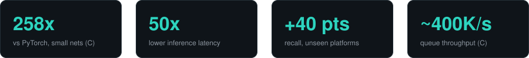

  <a href="https://linkedin.com/in/odeliya-charitonova">LinkedIn</a> ·
  <a href="mailto:odeliya.charitonova.dev@gmail.com">Email</a> ·
  <a href="https://github.com/odeliyach/AlgoShield-Algospeak-Detection/blob/main/NLP_finale_paper.pdf">AlgoShield paper</a> ·
  <a href="https://huggingface.co/spaces/odeliyach/AlgoScope">AlgoScope live demo</a>

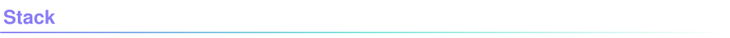

  <strong>Languages</strong> 
  
  
  
  
  
  
  

  <strong>Systems</strong> 
  
  
  
  
  
  
  
  

  <strong>ML & NLP</strong> 
  
  
  
  
  
  
  
  
  

  <strong>AI & Automation</strong> 
  
  
  
  
  
  

  <strong>Backend & Data</strong> 
  
  
  
  
  
  
  

  <strong>DevOps & Cloud</strong> 
  
  
  
  
  
  
  

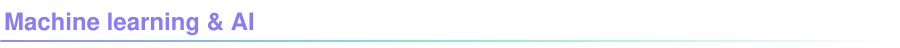

  <a href="https://github.com/odeliyach/AlgoShield-Algospeak-Detection">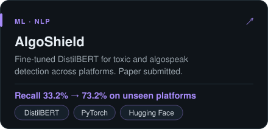</a>
  <a href="https://github.com/odeliyach/Algoscope">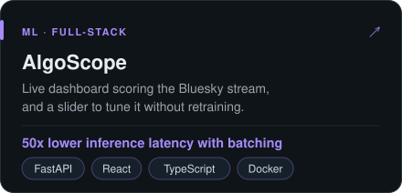</a>

  <a href="https://github.com/odeliyach/tiny-ml-runtime">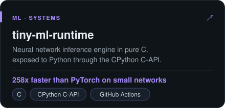</a>
  <a href="https://github.com/odeliyach/CareerOS">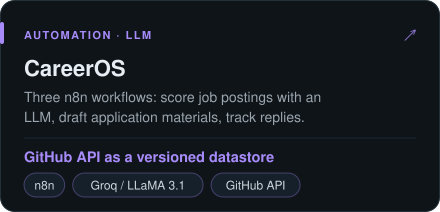</a>

  <a href="https://github.com/odeliyach/Group2">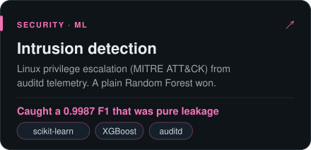</a>
  <a href="https://github.com/odeliyach/llm-side-channel-topic-classification">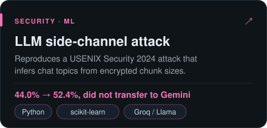</a>

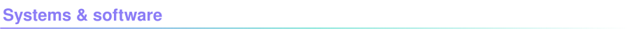

  <a href="https://github.com/odeliyach/Linux-System-Programming">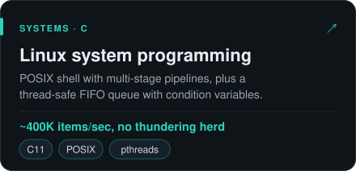</a>
  <a href="https://github.com/odeliyach/Kernel-Development-Lab">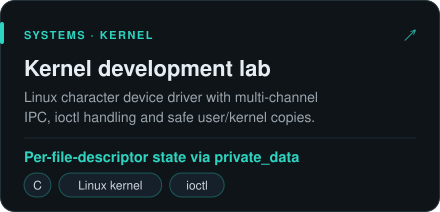</a>

  <a href="https://github.com/odeliyach/Network-Infrastructure-C">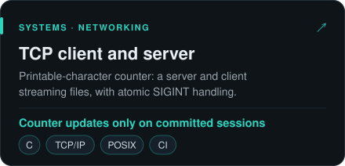</a>
  <a href="https://github.com/odeliyach/android-cosmetics-store">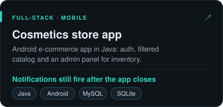</a>

  Also: <a href="https://github.com/odeliyach/Clustering-Algorithms-Lab">Clustering-Algorithms-Lab</a> ·
  <a href="https://github.com/odeliyach/my-project-template">my-project-template</a>

  

